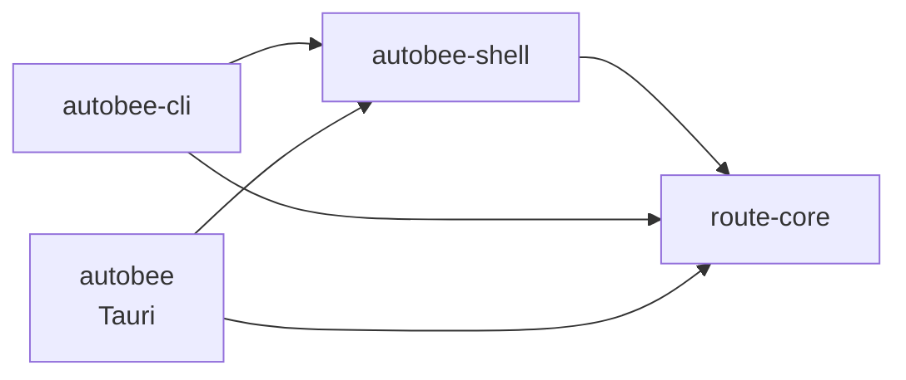

# AutoBee CLI 详细设计

> 状态:**待评审**。本文描述尚未实现的能力。
> 上位文档:`AutoBee-概要设计.md` 第 3.3 节。
> 姊妹文档:`AutoBee-大模型能力接入设计方案.md`(应用内对话,与本文不是同一件事)。

## 0. 这份文档要回答的问题

「把算路能力封装成 CLI,复用度是不是更高?」

答案:**是,但复用的是另一个维度,而且不是给应用内的对话框用的。** 第 1 节把这件事说清楚,因为它决定了后面每一个设计选择。

## 1. 复用度:两个维度,别混

「复用」不是一个维度,是两个。混在一起谈就会得出错误结论。

### 1.1 维度一:调用方复用(CLI 不占优)

同一个进程、同一门语言里的多个调用方共享一份逻辑 —— 这个维度上 **CLI 没有优势,因为共享层已经存在**:`route-core` 就是那一层,图形界面与模型 tool 调的是同一个 `planner::plan_route()`。

CLI 在这里只是多一层包装。多加一个 `autobee-cli route --from ... --to ...` 不会让界面和模型更「共享」,它们本来就共享。

### 1.2 维度二:跨边界复用(CLI 是唯一出路)

库有一个硬边界:**只能被同语言、同进程的调用方使用。** 想用 `route-core` 就得写 Rust 并链接它。

CLI 没有这个边界。任何能起子进程的东西都能用:

| 调用方 | 走库 | 走 CLI |
| --- | --- | --- |
| Python 脚本 | 写 FFI 或 PyO3 绑定 | `subprocess.run([...])` |
| 定时任务 / n8n | 不可能 | 一行命令 |
| 别的 agent 框架 | 按框架语言重写绑定 | 注册一个 shell tool |
| 你自己在终端里 | 不可能 | 直接敲 |

这台机器的 `ai/` 目录下就有多个互不相关的项目。将来任意一个想用 AutoBee 的算路:走库要 Rust 链接,走 CLI 一行 `subprocess.run` 就完了。

**结论:如果算路只服务 AutoBee 自己,库够了;如果它要成为工具箱里一个可被任意东西调用的能力,CLI 是唯一出路。**

## 2. 「CLI 对大模型更友好」:分场景,一半成立

这句话在**编码 agent** 场景完全成立,在**应用内 function calling** 场景不成立。两者别混。

### 2.1 编码 agent:成立

Claude Code / Codex 这类 agent 只有一个 shell 工具,却能操作上千种能力,靠的正是 CLI 的三个性质:

- **可发现**:`--help` 本身就是文档,不需要预注册 schema
- **可组合**:管道能把三个命令串起来,组合方式不必事先设计
- **可自解释**:报错文本是给人看的,模型读同一份文本

这个场景下 AutoBee CLI 有真实价值,而且是本方案的主要目标用户。

### 2.2 应用内对话框:不成立

AutoBee 的对话框走的是 function calling,模型收到的是 JSON schema:

| 维度 | function calling | 经 CLI 转一道 |
| --- | --- | --- |
| 参数 | 类型化字段,`enum` 约束 | 字符串,要处理引号与转义 |
| 非法值 | `parse` 当场挡下,返回 `BAD_MODE` 并列出合法值 | 退化成 exit code |
| 结果 | 结构化 JSON,直接回灌 `planner` | stdout 文本,要再解析一次 |
| 延迟 | 函数调用 | 多一次进程创建(Windows 上 30-50ms) |

**应用内让模型去 spawn 自己的 exe 是负优化。** 它要付进程创建、文本序列化、再解析回来的代价,换到的东西比直接调函数更少。

但这里有一点你的直觉是对的:**CLI 会强迫你把参数纪律做成一个明确的契约**,坏输入就报错。而这正是值得移植回去的 —— 之前 `plan_route` 对不认识的 `mode` 兜底猜「地铁」,模型拿到一份看似正常实为默认参数的结果,它分辨不出错、也就无法重试。

这条已经改完(`commands.rs:205-214`,`BAD_MODE` / `BAD_SORT`,合法值来自 `TravelMode::ALL` / `SortBy::ALL`)。**用 CLI 的标准要求参数,但不必付 CLI 的代价。**

## 3. 落点:第三个 crate,不是第二个 bin

### 3.1 两个硬约束(已核实)

**约束一:不能给现有 exe 加子命令。** `main.rs:4` 是 `#![cfg_attr(not(debug_assertions), windows_subsystem = "windows")]`。release 构建的 exe **不带控制台**,在终端里跑它 CLI 模式会「什么都不输出」—— 不是报错,是静默。调试构建下又是正常的,于是这类问题只在分发后出现。

**约束二:CLI 要读密钥,密钥读取在外壳层。** `route-core` 只收一份填好的 `Config`(`core/src/config.rs:5-7`),从 SQLite + DPAPI 把它拼出来的是 `credentials/resolve.rs::load_config()`,那在 `autobee` crate 里。

### 3.2 为什么是拆 crate 而不是加 bin

最省事的做法是在 `autobee` 包里加第二个 `[[bin]]`。它能编过,但那个 bin 会链接整个 `tauri` —— 一个不开窗口的命令行工具背着 WebView2 依赖与十几分钟的编译。

已核实的结构事实,使得拆分几乎是免费的:

| 模块 | 依赖 Tauri | 反向依赖 `commands` |
| --- | --- | --- |
| `paths.rs` | 否 | 否 |
| `error.rs` | 否(只 `pub use route_core::error::AppError`) | 否 |
| `logging.rs` | 否(`tracing-subscriber`) | 否 |
| `logs.rs` | 否 | 否 |
| `credentials/` | 否(`rusqlite` + `windows` DPAPI) | 否 |
| `commands/` | **是** | — |

`grep crate::commands src-tauri/src` **零命中**:没有任何一个模块反向引用 `commands`,拆分不会出现循环。

### 3.3 目标结构

```text
src-tauri/
  core/            route-core    算路内核(不变)
  shell/           autobee-shell 密钥 · 路径 · 日志 · 档案库    <- 新增,从 src/ 搬
  cli/             autobee-cli   命令行入口                     <- 新增
  src/             autobee       Tauri 外壳,只剩 commands + run
```



`autobee` 与 `autobee-cli` 是并列的两个调用方,**都不是对方的父级**。这一点决定了将来删掉任意一个,另一个仍然能编译。

### 3.4 这次拆分的代价,说实话

搬五个模块 + 改 `use` 前缀,机械但不是零成本。愿意付的理由只有一条:**不拆就得让 CLI 链接 Tauri**,那是个永久成本,而拆分是一次性成本。

`cargo test -p autobee-shell` 顺带也会变快(不带 Tauri),这是 2.1 节那个决定的同一条收益再来一次。

## 4. 命令面

### 4.1 只暴露三个子命令

现有十一个 IPC command 里,**只有三个值得上 CLI**。判据:该命令的产出对应用外的调用方有意义。

| 子命令 | 对应 | 为什么上 |
| --- | --- | --- |
| `route` | `plan_route` | 核心能力 |
| `circle` | `get_life_circle` | 核心能力 |
| `suggest` | `suggest` | 前两个要用地名,这个把地名变成坐标 |

**不上的八个,以及为什么:**

| 命令 | 不上的理由 |
| --- | --- |
| `get_tile` | 产出是 base64 图片。要瓦片的人直接找瓦片服务,不绕 AutoBee |
| `get_map_sdk_key` | **会把明文密钥打到 stdout**,而 stdout 会进日志、进 shell 历史 |
| `list/save/delete/test_map_provider` | 配置动作,归图形界面。CLI 改配置等于第二套设置入口,两边校验必然漂开 |
| `get_settings` / `save_settings` | 同上 |
| `read_logs` | 日志是文本文件,`type` / `tail` 就够了 |

这不是砍功能省事,是**减少契约面**。每个上了 CLI 的命令都是一个要长期兼容的接口。

### 4.2 签名

```text
autobee-cli route   --from <地点> --to <地点> [--mode <出行方式>] [--sort <依据>]
autobee-cli circle  --at <lat,lng> [--crs <坐标系>] [--package <服务包>]
autobee-cli suggest --keyword <关键词> [--limit <n>]

全局:  [--json] [--out-crs <坐标系>] [--quiet]
       --help / -h / --version / -V
```

参数名与 `commands.rs` 的形参一一对应(`from` / `to` / `mode` / `sort`;`lat` `lng` 合成 `--at`,因为命令行上分开两个参数容易只写一个)。

**合法值不在本文档里列举。** 它们来自 `TravelMode::ALL` / `SortBy::ALL` / `Crs` / `LifeCirclePackage`,`--help` 直接打印那几个常量。文档里抄一份就会与代码漂开 —— 这正是概要设计 4.2 节「同一个常量用于三处」那条规则,`--help` 是第四处,同样不许抄。

### 4.3 默认值与图形界面一致

`--mode` 默认 `subway`,`--sort` 默认 `time`,`--out-crs` 默认 `Settings::default().out_crs`。

最后一条是硬要求,不是方便:同一个设置的默认值只许有一个来源。本项目在这一点上真实踩过坑(概要设计 4.3),CLI 不许再开一个分叉。

## 5. 输出契约

### 5.1 两种输出,默认给人看

不带 `--json` 时输出对齐的文本表格;带 `--json` 时输出 `RoutePlan` / `LifeCircle` / `Vec<Place>` 的 `serde_json` 序列化结果。

默认给人看,理由是 CLI 主要被人和编码 agent 用,而两者读的是同一份文本(第 2.1 节)。机器调用方多打一个 `--json` 的成本远低于人每次都要读 JSON。

**`--json` 的输出就是前端收到的那个结构**,不另造一套 DTO。另造一套就等于同一份数据两个契约,改一处漏一处。

### 5.2 stdout 与 stderr 分开

| 流 | 内容 |
| --- | --- |
| stdout | **只有结果**。`--json` 时是一个完整合法 JSON,前后无杂物 |
| stderr | 日志、警告、降级说明、错误 |

这条是给管道用的:`autobee-cli route ... --json | jq .routes[0]` 必须能工作。任何往 stdout 写进度或提示的行为都会破坏它。

降级说明(`RoutePlan.degraded`)进 stderr,同时**保留在 JSON 里** —— 人需要被告知「主服务挂了换了一家」,脚本需要能判断这件事。

### 5.3 exit code

**按 `code` 映射,不按 `status`。** `AppError` 带 `status: u16`(`core/src/error.rs:23-24`),但它不够分档:`BAD_MODE` 与 `BAIDU_KEY_REQUIRED` 都是 400,前者要人改命令、后者要人去填 AK,落在同一档就把两件事混了。映射规则:

| exit code | 含义 | 来源 |
| --- | --- | --- |
| `0` | 成功 | — |
| `2` | 参数错(用法问题) | 解析失败、`BAD_MODE` / `BAD_SORT` / `BAD_CRS` / `BAD_PACKAGE` |
| `3` | 输入无解(用法没错) | `RESOLVE_FAILED` / `NO_ROUTE` / `CROSS_BORDER` |
| `4` | 未配置 | `NO_PROVIDER` / `BAIDU_KEY_REQUIRED`(`commands.rs:323`) |
| `5` | 上游失败(可重试) | `UPSTREAM` / `NETWORK` / `ALL_PROVIDERS_FAILED` |
| `1` | 其他 | 兜底 |

分成这几档而不是「非 0 即错」,是因为调用方对它们的处置完全不同:`2` 要改命令,`4` 要去设置页填 Key,`5` 值得重试,`3` 重试一万次也没用。

**`code` 仍然是权威依据。** exit code 只有 6 个档位,`--json` 失败时 stderr 输出完整 `{code, message, status}`。脚本要精确分支就读 `code`,shell 里粗判就看 exit code。

## 6. 参数解析:手写,不引 clap

### 6.1 决定

用 `std::env::args()` 手写,约 80 行。

### 6.2 理由不是「少几个依赖」

`clap` 不在 `Cargo.lock` 里(已核实:`clap` / `clap_builder` / `clap_lex` / `anstyle` / `anstream` 零命中),引它会新增 8 个左右的 crate。但 lock 里已经有 521 个包,多 8 个不是决定性的。

**真正的理由是 `--help` 的内容来源。** 4.2 节定了:合法值必须从 `TravelMode::ALL` / `SortBy::ALL` 打印,不许抄一份。用 `clap` 的 derive 做这件事有两条路,都不好:

1. 给 `TravelMode` / `SortBy` / `Crs` / `LifeCirclePackage` 实现 `clap::ValueEnum` —— 这四个类型都在 `route-core` 里,**等于把 CLI 框架依赖装进算路内核**。内核不该知道自己被一个命令行工具调用(概要设计 2.1)。
2. 在 CLI 侧写 custom value parser —— 那已经把「解析枚举」这件唯一有意思的事手写完了,`clap` 只剩下 `--flag value` 的分词。

第 2 条路是大多数人的选择,而它说明 `clap` 在这里只承担了最简单的那部分。3 个子命令、6 个 flag 的分词不值得一个框架。

### 6.3 先例

同一个项目里,MCP 客户端也是手写而不引 SDK(`大模型能力接入设计方案` 7.3.1:只实现 `initialize` / `tools/list` / `tools/call` 四条消息)。判据一致:**协议面小到能一眼看完时,手写比依赖更省。**

### 6.4 手写要守住的几件事

手写参数解析的经典坑,一次写对:

- `--flag value` 与 `--flag=value` 两种写法都要认
- `--` 之后的内容不再当 flag(地名可能以 `-` 开头)
- 未知 flag **报错**,不静默忽略 —— 静默忽略等于让打错字的人拿到默认参数的结果,就是 2.2 节那个已修掉的错误再来一次
- 重复给同一个 flag 时报错,不静默取最后一个
- `--help` / `--version` 走到 exit code `0`,不是 `2`

这几条各自对应一个回归测试(第 8 节)。

## 7. 配置与密钥

### 7.1 复用,不新建

CLI 调 `autobee-shell` 的 `resolve::load_config()`,与图形界面**同一份** `settings.db`、同一套 DPAPI 解密。CLI 不新增配置文件、不读环境变量里的 Key。

一份配置两个入口共用,好处是在设置页填一次 Key,CLI 立刻能用;坏处是 CLI 在没跑过图形界面的机器上无法工作。接受这个坏处:AutoBee 是桌面应用,CLI 是它的附属入口,不是独立发行物。

### 7.2 DPAPI 是 per-user 的,这会咬人

**已核实的硬约束**(`credentials/crypto.rs:10-12`):DPAPI 密钥由 Windows 按登录凭据管,per-user 绑定,别的账户拿到 db 文件也解不开。而解不开时 `unprotect` 返回 `None`,被 `load_config` 当成「没填密钥」跳过(`resolve.rs:35-40`)。

推论:**CLI 必须以配置密钥的那个 Windows 账户运行。**

这条会在第 1.2 节最主要的那个用例上咬人 —— 计划任务默认跑在 `SYSTEM` 或服务账户下,那时:

1. `unprotect` 解不开 → 当成没填
2. `load_config` 得到一份空 `keys`
3. 算路报 `NO_PROVIDER`,文案是「请到设置页至少填一个服务商的 API Key」

用户会以为自己没填 Key,实际填了 —— **这是个静默错误**,正是本项目反复防的那一类。

处置:`NO_PROVIDER` 在 CLI 侧**加一句 CLI 专属的提示**,而不是照搬图形界面那句文案:

```text
错误 [NO_PROVIDER]: 没有可用的地图服务。
提示: 若已在设置页填过 Key,请确认本命令与图形界面运行在同一个 Windows 账户下
      —— 密钥按账户加密(DPAPI),换账户会读不到。当前账户: <whoami>
```

打印当前账户名,让人一眼看出是不是这个原因。`whoami` 不是密钥,打出来无风险。

### 7.3 密钥永不上 stdout

`get_map_sdk_key` 不上 CLI(4.1 节)。此外 CLI 的日志走 `autobee-shell` 的 `logging.rs`,密钥经 `mask_secret` 掩码(留头尾各四位)。

`--json` 的输出里没有任何密钥字段 —— `RoutePlan` / `LifeCircle` / `Place` 都不含密钥,这一点由类型保证,不靠自觉。

## 8. 测试策略

沿用项目约定:模块内 `mod tests`、中文测试函数名、测试模块顶部 `#[allow(clippy::unwrap_used, reason = "...")]`。**项目里没有 `tests/` 目录**(已核实:9 个测试模块全在源文件内),CLI 不新开这个先例。

### 8.1 值得写的

参数解析是纯函数(`&[String] -> Result<Command, AppError>`),不碰网络、不碰磁盘,单测成本极低而回归价值高。

| 测试 | 断言什么 | 为什么值得 |
| --- | --- | --- |
| `两种写法都认` | `--mode subway` 与 `--mode=subway` 解析结果相同 | 两条分词路径,容易只写对一条 |
| `未知 flag 报错而不是忽略` | `--nonsense` → `Err`,exit `2` | 静默忽略会让打错字的人拿到默认参数的结果 |
| `重复 flag 报错` | `--mode a --mode b` → `Err` | 静默取最后一个时,写错的人不知道前一个被丢了 |
| `双横线之后不当 flag` | `-- --from` 被当地名 | 地名可能以 `-` 开头 |
| `缺必填参数报错并指出缺哪个` | 少 `--to` → message 含 `--to` | 只说「参数错误」的报错要人猜 |
| `不认识的枚举值报错并列出合法值` | `--mode transit` → `BAD_MODE`,message 含 `TravelMode::ALL` 各值 | 这是 CLI 存在的那条纪律本身 |
| `错误码映射到分档 exit code` | `NO_PROVIDER` → `4`,`NETWORK` → `5` | 脚本按档位分支,映射错了重试逻辑就错 |
| `help 与 version 退出码为 0` | 不是 `2` | `--help` 是正常用法,返回非 0 会让 CI 判失败 |

### 8.2 不写的

- **不测 `route` 真的能算出路线** —— 那要网络和真 Key,是冒烟的事,不是单测。`route-core` 的 50 个单测已经守住算路本身。
- **不测 `--json` 的具体字段** —— 那些结构的序列化归 `route-core` 的类型管,在 CLI 侧再断言一遍只是把同一件事钉两次。
- **不给每个子命令写一遍同形状的参数表** —— 三个子命令走同一个解析器,同一条路径测一次就够。

### 8.3 冒烟验证

单测之外,交付前手工跑一遍(这才是「能用」的证据):

```text
autobee-cli route --from 南京南站 --to 新街口 --mode subway
autobee-cli route --from 南京南站 --to 新街口 --json | jq -e '.routes|length>0'
autobee-cli route --from x --to y --mode transit          # 期望 exit 2 + 列出合法值
autobee-cli suggest --keyword 孝陵卫
autobee-cli circle --at 32.0603,118.7969 --package care
autobee-cli --help                                        # 期望 exit 0
```

第二条用 `jq -e` 是刻意的:它同时验证「stdout 是一个干净 JSON」(5.2 节)与「结果非空」。

## 9. 实施任务清单

每个任务写明**改哪个文件**、**做什么**、**怎么算完成**。任务按依赖排序:前一个的完成判据没过,不要开下一个。

判据一律是可运行的命令或可观察的现象,不是「写完了」。

### C1 拆出 `autobee-shell`

这一组**不新增任何行为**,纯搬迁。搬完行为若有变化,说明搬错了。

- [x] **C1-1 建 crate 骨架**
  - 新建 `src-tauri/shell/Cargo.toml`:`name = "autobee-shell"`、`edition = "2024"`。
  - 依赖照抄根包 `Cargo.toml:24-50` 里这几项:`route-core`(path `../core`)、`serde`、`serde_json`、`thiserror`、`tracing`、`tracing-subscriber`、`rusqlite`(features `["bundled"]`)。
  - **`[target.'cfg(windows)'.dependencies]` 那段 `windows` 必须一起搬**(`Cargo.toml:46-50`,两个 feature)。漏了它 `crypto.rs` 的 `#[cfg(windows)]` 会静默不编译,DPAPI 变成空实现,而测试不会失败 —— 见 10.1。
  - `[lints]` 两段照抄。
  - 判据:`src-tauri/shell/src/lib.rs` 里只写 `//! doc` 时,`cargo build -p autobee-shell` 通过。
  - 实际:`members` 那一行必须在这一步就改(`shell/` 在根包目录内,不进 `members` 时 cargo 报「包不在 workspace 里」,判据跑不了)。已完成。
- [x] **C1-2 搬模块**
  - 从 `src-tauri/src/` 移到 `src-tauri/shell/src/`:`paths.rs`、`error.rs`、`logging.rs`、`logs.rs`、`credentials/`(整个目录 5 个文件)。
  - `shell/src/lib.rs` 声明这五个 `pub mod`,模块顺序与原 `lib.rs:5-10` 一致(去掉 `commands`)。
  - 模块内的 `use crate::xxx` 不用改:它们互相引用的还是同一个 crate 内的模块。
  - 判据:`cargo test -p autobee-shell` 跑出 **35 个**测试全绿(与搬迁前根包的 35 个一一对应)。已完成:35 passed。
- [x] **C1-3 接回根包**
  - `src-tauri/Cargo.toml`:`members` 从 `["core"]` 改成 `["core", "shell"]`;`[dependencies]` 加 `autobee-shell = { path = "shell" }`。
  - 根包 `src/lib.rs` 只剩 `pub mod commands;`。
  - `commands.rs` 的 `use crate::credentials::…` / `crate::error::…` / `crate::logs::…` / `crate::paths::…` / `crate::logging::…` 全改成 `autobee_shell::…`。`grep -n "crate::" src-tauri/src/commands.rs` 应只剩 `crate::` 之外的路径。
  - 判据:`pnpm verify` 全绿;`pnpm dev:app` 起来后设置页能**填一个 Key 并读回掩码**。这一条必须手动点一次 —— 它是 10.1 那个 `#[cfg(windows)]` 陷阱唯一的检出手段,`cargo test` 检不出来。
  - 实际:`pnpm verify` 全绿(前端 56 + shell 36 + core 50 + clippy + fmt)。搬完后根包不再直接依赖 `rusqlite`/`tracing-subscriber`/`serde`/`serde_json`/`thiserror`/`windows`,已从根 `Cargo.toml` 删除。`grep -n "crate::" src-tauri/src/*.rs` 零命中。
  - **手动那条已改成自动化**:`store.rs` 新增测试「真实文件路径上密钥能加密落盘再读回」,走 `open_at`(不是 `memory()`)存 Key、读回明文、并断言 db 文件里搜不到明文。已验证它真能检出陷阱 —— 把 `protect` 临时改成返回 `None` 后该测试 FAILED(`ENCRYPT_FAILED`)。所以 10.1 那个陷阱不再依赖人工点界面。
- [x] **C1-4 守住可见性**
  - `crypto.rs` 的 `protect` / `unprotect` 保持 `pub(crate)`。换了 crate 之后 `store.rs` 仍与它同 crate,不需要放开。
  - 判据:`grep -n "pub fn protect\|pub fn unprotect" src-tauri/shell/src/credentials/crypto.rs` 零命中(只有 `pub(crate) fn`)。已完成:零命中,四处全是 `pub(crate)`。

### C2 参数解析 + `route`

- [x] **C2-1 建 `autobee-cli` crate**
  - 新建 `src-tauri/cli/Cargo.toml`:`name = "autobee-cli"`、`edition = "2024"`,依赖 `route-core`(path `../core`)、`autobee-shell`(path `../shell`)、`serde_json`、`tracing`、`tracing-subscriber`。**不依赖 `tauri`**。
  - `members` 加 `"cli"`。
  - `src-tauri/cli/src/main.rs` 顶部放 `#![cfg_attr(not(debug_assertions), windows_subsystem = "console")]` —— 不写默认就是 console,但显式写出来是为了挡住「照抄 GUI 的 `windows_subsystem = "windows"`」这个手滑,那会让 CLI 一个字都不输出(3.1 约束一)。
  - 判据:`cargo build -p autobee-cli` 通过,`cargo tree -p autobee-cli | grep -c "^tauri"` 为 0。已完成:构建 0 warning,依赖树 130 个 crate 里**没有一个 crate 名含 `tauri`**。
  - **判据本身有个坑**:裸 `grep tauri` 会有 4 行命中,那是路径里的目录名 `src-tauri`,不是依赖。必须像判据写的那样用行首锚定 `^tauri`,否则会误判成「依赖了 tauri」。
- [x] **C2-2 写 `args.rs` 的分词器**
  - 签名 `pub fn parse(argv: &[String]) -> Result<Command, AppError>`,纯函数,不读 env、不读磁盘 —— 这样 8.1 的单测才能直接喂数组。
  - `enum Command { Route{…}, Suggest{…}, Circle{…}, Help, Version }`。
  - 守住 6.4 的五条:`--flag value` 与 `--flag=value` 都认;`--` 之后不当 flag;未知 flag 报错;重复 flag 报错;`Help` / `Version` 不是错误分支。
  - 缺必填参数时 message 里带上缺的那个 flag 名(8.1 第五行)。
  - 判据:`mod tests` 里 8.1 表格的前六行各一个测试,`cargo test -p autobee-cli` 全绿。已完成:8.1 八行**各有一条对应测试**(前六行 = `args.rs` 的 411/427/439/450/461/473 行),`cargo test -p autobee-cli` 16 passed。
- [x] **C2-3 枚举值从 `ALL` 打印**
  - `--mode` / `--sort` / `--out-crs` / `--package` 分别用 `TravelMode::parse` / `SortBy::parse` / `Crs::parse` / `LifeCirclePackage::parse`;失败时 message 由 `TravelMode::ALL` 等**拼出来**,不写字面量列表。
  - `--help` 的合法值同样从 `ALL` 拼。
  - 判据:`grep -n '"subway"\|"walking"\|"driving"' src-tauri/cli/src/` 在 `args.rs` 里零命中(只许出现在 `route-core`)。已完成:`args.rs` / `run.rs` / `output.rs` / `main.rs` 四个文件的**生产代码段零命中**。
  - **判据需要按意图读,不能按字面读**:`mod tests` 里有 `"walking"` / `"bus"`,那是喂给 `parse` 的**输入串**,不是合法值列表。测试必须写具体输入,否则它没在测任何东西。判据真正约束的是「报错与 help 的合法值列表不许抄一份」。
  - `lower()` 用 `Debug` 派生名转小写而不是手写 match:手写那份会在加枚举值时被忘掉,而 `Debug` 是编译器生成的。
- [x] **C2-4 exit code 映射**
  - `fn exit_code(code: &str) -> i32`,按 5.3 的表。
  - `BAIDU_KEY_REQUIRED` 归 `4`:它与 `NO_PROVIDER` 是同一类「去设置页填东西」,5.3 的表已经把两者并列在同一档,照表实现即可,别让两个同类错误落到不同档。
  - 判据:8.1 第七行的测试,含 `NO_PROVIDER` → `4`、`BAIDU_KEY_REQUIRED` → `4`、`NETWORK` → `5`。已完成:`args.rs:499` 的 `错误码映射到分档_exit_code`,三条都在,另含 `SOMETHING_NEW` → `1` —— 没列过的码落兜底档而不是 0,否则脚本会把未知错误当成功。
- [x] **C2-5 接上 `route`**
  - `autobee_shell::credentials::resolve::load_config()` → `route_core::planner::plan_route(&config, &RouteQuery{…})` → `convert_plan` 到 `--out-crs`。
  - 输出层:`--json` 打 `serde_json::to_string(&plan)` 到 stdout;否则打对齐文本表格。`plan.degraded` 走 stderr 且**留在 JSON 里**(5.2)。
  - `tracing_subscriber` 的 writer 设成 stderr —— 默认是 stdout,不改就会把日志混进 `--json` 的输出里,5.2 那条管道契约当场破。
  - 判据:8.3 前三条冒烟通过,其中 `--mode transit` 给出 exit 2 且 stderr 里能看到合法值列表。已完成,实测(南京南站 → 新街口,百度 AK):
    - 第一条:exit 0,5 条方案,stderr 空。
    - 第二条:`--json | jq -e -f` 输出 `true`、exit 0 —— stdout 是干净可解析 JSON 且方案非空。
    - 第三条:exit 2,stderr 为 `BAD_MODE: --mode 不认识的值「transit」,可选:subway / bus / walking`,stdout 空。
  - **验收时发现并修掉两个真 bug:**
    - `degraded` 原本被拼进 stdout 的文本里,违反 5.2。已抽成 `output::degraded_note`,由 `run::report` 的新增 `note` 参数在**两条路径**上都打到 stderr,同时保留在 JSON 的 `degraded` 字段里(人看 stderr、脚本读字段)。
    - **`Route.duration` 的单位是分钟,不是秒**(`models.rs:304`)。摘要行原本又套了一层 `秒 → 分钟`,于是 29 分钟的地铁方案显示成「1 分钟」—— 不 panic、不报错,只是把数字说错。已把那个 helper 改名为 `sec_to_minutes`(名字带单位才防复发),它现在只用于 `walk_duration_sec`。
  - 三条新测试钉住以上两点,并都做了变异验证(把实现改坏确认测试真会红):`降级说明不进_stdout_文本`、`降级说明走_stderr_那一路`、`降级说明留在_json_里`、`方案耗时按分钟显示不再除一次六十`。
  - **`--json` 用的是 `to_string_pretty` 而不是 `to_string`**:管道里两者都合法,人直接看时可读性差别很大。
  - 冒烟要灌 Key 才能跑:CLI 按设计不写配置(4.1),验收时用一个走 `Store::save` 的一次性 example 灌进 `settings.db`(与设置页同一条 DPAPI 路径,直接写 SQL 明文的话 CLI 读不出来),跑完即删。

### C3 `suggest` + `circle`

- [x] **C3-1 `suggest`**
  - 走 `route_core::planner::suggest_places(&config, keyword, page_size)`,`page_size` 默认 10。它返回 `Vec<Place>` 而不是 `Result` —— 空结果不是错误,按 exit 0 输出空表/空 JSON 数组。
  - 判据:`autobee-cli suggest --keyword 孝陵卫` 有输出且 exit 0。已完成:10 条结果、exit 0、stderr 空。
  - **文档没写但实现里有、且必须有的一条**:`suggest_places` 返回的坐标是**各家自己的原生坐标系**(高德/腾讯 GCJ02、百度 BD09、天地图 CGCS2000),它不做换算。GUI 那边不换没事,因为它只把点画在同样是 GCJ02 的底图上;CLI 的调用方拿到坐标要自己用,不统一就会偏几百米。`run.rs:86-90` 按 `get_meta(provider).coord_sys` 逐条换到 `--out-crs`。
  - 另一条:`suggest_places` 返回裸 `Vec`,拿不到「为什么空」。一个 Key 都没配时它也返回空 —— 那种情况必须报 `NO_PROVIDER` 而不是装作搜不到,否则人会一直换关键词。判断用 `registry::default_chain(&config).is_empty()` 而不是自己数 `config.keys`:候选链还受 disabled 与 `default_providers` 影响,自己数会与 planner 真正走的链路不一致。
- [x] **C3-2 `circle`**
  - `--at` 用 `route_core::decode::parse_lat_lng`(`core/src/decode.rs:44`),**不自己写**坐标文本解析。
  - 抄 `commands.rs:312-340` 的流程:`config.key(ProviderId::Baidu)` 取 AK(缺则 `BAIDU_KEY_REQUIRED`)→ 入参转 `Crs::Bd09` → `life_circle::life_circle(key, origin, package)` → 把每个 `poi.location` 转回 `--out-crs`,并置 `circle.crs`。
  - 那两次坐标系转换不是可选的:`life_circle` 只认 BD09,漏掉回转会让 POI 在图上整体偏出几百米,而返回值看着完全正常。
  - 判据:8.3 第五条冒烟通过;未填 AK 时 exit 4 且 stderr 提示去设置页。已完成:
    - `--at 32.0603,118.7969 --package care` → 4 个可达点、exit 0、输出头标「坐标系 Gcj02」(已从 BD09 转回)。
    - 只清掉百度 AK、留着高德时 → exit 4,stderr 为 `BAIDU_KEY_REQUIRED: 请到设置页填写百度地图 Web 服务 AK`,stdout 空。
  - **验这条要留着另一家的 Key。** 把整个 `settings.db` 清空的话走的是 `NO_PROVIDER`(一个 Key 都没配),那是另一条分支 —— 两者都是 exit 4,光看退出码分不出来,必须核对 `code`。
  - 顺带印证了 C2-5 那条 writer 设置:`tracing` 的 WARN 行确实落在 stderr,stdout 全空。

### C4 进构建管线

- [x] **C4-1 编译进 release**
  - `scripts/build-app.bat` 的 `[4/6]`(`tauri build`,现 124 行附近)之后加一步 `cargo build --release -p autobee-cli`,失败即 `goto fail`。
  - 判据:`pnpm build:app` 跑到这一步不中断,`src-tauri\target\release\autobee-cli.exe` 存在。已完成:整条 `build-app.bat` 跑通(122 秒),CLI 3.3 MB、GUI 6.0 MB,NSIS 安装包与 portable zip 都产出了。
  - 调用的是 `%ROOT%scripts\cargo-msvc.bat` 而不是裸 `cargo`:裸 `cargo` 会被 Git 自带的 coreutils `link.exe` 遮蔽 MSVC 链接器而链接失败。
- [x] **C4-2 收进 `dist\`**
  - `[5/6]` 收集时把 `autobee-cli.exe` 一并拷进 `%DIST%`,与 `AutoBee.exe` 并列。
  - 判据:`dir /b "%DIST%\*.exe"` 列出两个 exe;portable zip 里也有两个。已完成:两者都在,zip 里是 `AutoBee/autobee-cli.exe` 与 `AutoBee/AutoBee.exe`。
  - **验这条时发现一个真缺陷并修掉了:portable zip 把 `data\settings.db` 一起打进去了。** `[5/6]` 原本只往 `%DIST%` 里拷、从不清空,而运行期数据按设计就落在 exe 同目录的 `data\`(`shell\src\paths.rs`)—— 在本机跑过一次打包产物,`%DIST%\data` 就有了档案库和日志,`Compress-Archive` 打整个目录,于是**本机的凭据库进了分发包**。DPAPI 按账户绑定使得那份 Key 在别人机器上解不开,但分发一个凭据文件本身就不对。修法:`[5/6]` 开头 `rd /s /q "%DIST%"` 先清空载荷目录。
- [x] **C4-3 确认质量门不用改**
  - `[3/6]` 的 `pnpm verify` 不需要动:`test:rust` 已是 `--workspace`,`clippy` 已是 `--workspace --all-targets`,新 crate 自动进门。
  - 判据:`pnpm verify` 的输出里出现 `autobee-cli` 的测试行(证明它真进了门,而不是被跳过)。已完成:输出里有 `autobee_cli-<hash>.exe ... 16 passed`。全门实测:前端 82、CLI 16、shell 42、core 64,svelte-check 353 文件 0 错 0 警,clippy 与 eslint 0 问题,fmt 干净。
- [x] **C4-4 冒烟**
  - 在 `dist\` 里用 cmd 直接跑 8.3 那六条。
  - 判据:六条全过。这一条就是 3.1 约束一的回归 —— 只有在打包产物上跑才算。已完成,在 `dist\AutoBee` 里对 release exe 实测:route 文本 `0`、`--json | jq -e` 输出 `true` 且 `0`、`--mode transit` → `2`、suggest `0`、circle `0`、`--help` `0`。
  - 另落了一个可重跑的脚本 `scripts/smoke-cli.mjs`(`pnpm smoke:cli`),默认对着 `dist\AutoBee` 跑,14 项检查。
  - **它是 `.mjs` 而不是 `.bat`,原因是硬的**:判据里的地名是中文,而 `.bat` 必须保持纯 ASCII(cmd.exe 按 OEM 代码页读文件,行内 UTF-8 中文会破坏解析)。中文放进 Node 的参数数组由 `spawnSync` 直接传,绕开整个代码页问题。
  - 脚本在没配 Key 时把算路那几条报 **SKIP 而不是 PASS**:全新安装的档案库是空的,把「没验」记成「通过」会让这条判据失去意义。空载荷实测 8 项通过、6 项 SKIP。
  - 那 8 项里有一条专门盯 3.1 约束一:`--help` 不只要 exit 0,还要真打出 200 字节以上的用法。exit 0 却一个字不输出正是 `windows_subsystem` 写错时的表现,而它**只在 release 生效** —— debug 全绿而 release 静默是可能的,所以必须对打包产物跑。

## 10. 风险与规避

### 10.1 破坏性改动:搬走五个模块

C1 会动 `src-tauri/src/` 的模块布局,`commands.rs` 的 `use` 全部要改。风险是搬迁过程中漏掉一处,而 Rust 编译器会全部指出来 —— 这是一次**编译期可验证**的改动,不会留下运行期隐患。

真正的风险在 `crypto.rs` 的 `#[cfg(windows)]`:搬 crate 时若漏带 `Cargo.toml` 里那段 `[target.'cfg(windows)'.dependencies]`,`windows` crate 就没了,而 `#[cfg(windows)]` 的代码会**静默不编译**、非 Windows 分支接管。C1 的验收必须包含「设置页能读写 Key」而不只是 `cargo test`。

### 10.2 两个入口写同一个 db

CLI 与图形界面同时跑时会有两个进程开同一个 SQLite 文件。CLI 只**读**配置(4.1 节砍掉了所有写配置的命令),SQLite 的多读单写模型下没有问题。

**这条依赖于「CLI 不写配置」。** 将来若有人要加 `autobee-cli config set`,先回到 4.1 节重新论证,别直接加。

### 10.3 DPAPI 账户陷阱

见 7.2。这是本方案最可能实际咬到人的一条,规避手段是那句 CLI 专属提示 + 打印当前账户名。

### 10.4 CLI 成为第二个事实契约

一旦有脚本依赖 `--json` 的输出形状,`RoutePlan` 的字段就不能随便改了 —— 而它现在只服务前端,改起来是自由的。

规避:`--json` 直接序列化 `route-core` 的类型,不另造 DTO(5.1 节)。这样契约只有一份,改它的时候前端会一起报错,不会出现「前端改了、脚本静默拿到旧字段」。

## 11. 评审问题清单

| # | 问题 | 我的建议 |
| --- | --- | --- |
| 1 | CLI 是否值得做? | 值得,但理由是跨边界复用(1.2),不是应用内复用 |
| 2 | 拆 `autobee-shell` 还是让 CLI 链接 Tauri? | 拆。不拆是永久成本,拆是一次性成本(3.4) |
| 3 | 手写参数解析还是引 `clap`? | 手写。理由是 `--help` 的合法值必须来自内核常量,用 derive 会把 `clap` 装进 `route-core`(6.2) |
| 4 | 只暴露三个子命令够不够? | 够。配置类动作归图形界面,CLI 改配置等于第二套设置入口(4.1) |
| 5 | exit code 分 6 档还是「非 0 即错」? | 分档。调用方对参数错/无解/未配置/可重试的处置完全不同(5.3) |
| 6 | 默认输出给人看还是给机器看? | 给人。主要用户是人与编码 agent,机器方多打一个 `--json`(5.1) |
| 7 | 与大模型那份文档的优先级? | CLI 排在 M1-M5 之后。它不服务参赛主链路,也不服务应用内对话 |

## 12. 评审结论

> 待填。评审通过后在此记录:结论、被否决的项、被修改的决策,然后进 C1。


