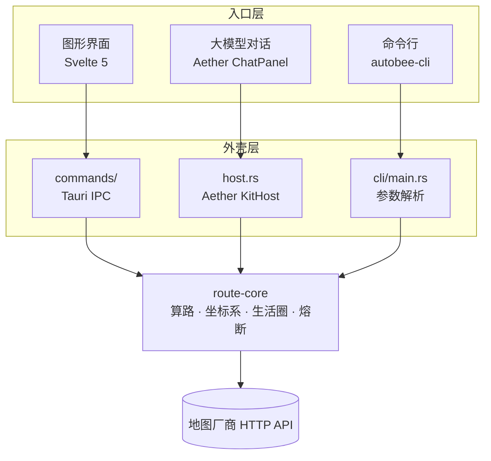

# AutoBee 概要设计

> 状态:**现状 + 已定方向**。本文描述整体分层与边界,不含实现细节。
> 详细设计分散在:`AutoBee-百度地图大赛设计方案.md`(参赛主链路)、
> `AutoBee-大模型能力接入设计方案.md`(对话与 tool calling)、
> `AutoBee-CLI-设计方案.md`(命令行入口)。
>
> 本文回答一个问题:**这些东西怎么拼在一起,各自的边界在哪。**

## 1. 一句话架构

AutoBee 是一个**算路内核 + 三个入口**的桌面应用。内核 `route-core` 不依赖 Tauri、不依赖任何 UI、不知道自己被谁调用;三个入口(图形界面、大模型对话、命令行)都只是它的调用方。

**这张图只有一条规则:所有箭头都汇聚到 `route-core`,没有任何入口绕过它。** 违反它就会出现「界面算出来的路线」和「模型讲出来的路线」两个版本,用户无法判断谁是真的。

## 2. 分层与职责

| 层 | 位置 | 职责 | 明确不做 |
| --- | --- | --- | --- |
| 内核 | `src-tauri/core/` | 算路、坐标系换算、生活圈、厂商降级、熔断 | 不知道 Tauri、不知道 UI、不碰数据库 |
| 外壳 | `src-tauri/src/` | IPC command、密钥存取(DPAPI)、日志、回合循环 | 不含业务逻辑 |
| 入口 | `src/`(前端)、`llm/`、`cli/` | 收集意图、展示结果 | 不重复实现任何算路逻辑 |

### 2.1 为什么内核单独成 crate

理由写在 `src-tauri/Cargo.toml:2-4`:`cargo test -p route-core` 几十秒跑完,带 Tauri 的完整编译要十几分钟。算路、坐标系、解码这些逻辑的回归主要靠单测,不该被 GUI 依赖的编译时间拖住。

**这个决定的副作用后来变成了主要收益**:因为内核不依赖 Tauri,CLI 入口几乎是免费的 —— 它不需要窗口、不需要 WebView,直接链接内核即可。

### 2.2 内核为什么是 blocking

`route-core` 全程同步阻塞(`core/Cargo.toml:13-15`)。算路是「一次请求等一次响应」,引 async 会传染整条调用链。调用方自己负责丢到阻塞线程池:Tauri command 用 `tauri::async_runtime::spawn_blocking`,模型侧同理,CLI 则根本不需要 —— 它本来就是同步的一次性进程。

## 3. 三个入口的边界

### 3.1 图形界面:工作台结构

一句话:**左栏提问,右图作答。**

`src/routes/+page.svelte` 是单页工作台,header 一条 nav 切换视图,左栏 400px 放输入与结果列表,右侧 `main` 是地图。视图顺序:

**安心换乘 → 15 分钟生活圈 → AI 助手 → 日志**

日志排最后,因为它是排查用的,且靠 `SettingsDto.show_logs` 控制显隐。

地图(`MapCanvas.svelte`)直接读 `planner` 状态,不接受参数 —— 这个耦合是刻意的,它使得**任何**产出路线的路径(手动规划或模型 tool)只要写进 `planner` 就能画出来。

### 3.2 大模型对话:第四个视图,不是独立页

对话复用上面那套左栏 + 地图。**不是** `/chat` 独立路由。

否决独立路由的理由是硬约束:`MapCanvas.svelte:3` 直接 `import { planner }`,独立页面上没有地图,模型 tool 拿回的路线只能以文字存在 —— 而地图是参赛核心性所在。一个算得出路线却画不出路线的对话框,比没有对话框更糟。

模型通过 tool 调用内核,结果**回灌** `planner`,于是地图自动更新。裁剪版结果进模型上下文(省 token),完整版进 `planner`(地图要折线才画得出线)。

详见 `AutoBee-大模型能力接入设计方案.md` 第 6 节。

### 3.3 命令行:给应用外的调用方

CLI 存在的理由**不是**给应用内的对话框用 —— 对话框走 function calling 更合适(JSON schema 约束参数,比命令行字符串更严)。

CLI 的理由是**跨边界复用**:库只能被同语言同进程的调用方用,CLI 能被任何东西用 —— Python 脚本、定时任务、n8n、别的 agent 框架、直接在终端里敲。

详见 `AutoBee-CLI-设计方案.md`。

## 4. 贯穿三个入口的契约

### 4.1 错误码而不是错误文案

`AppError` 带 `code`(机器可读)+ `message`(中文,给人看)+ `status`。**所有入口按 `code` 分支**,不匹配中文 —— 改文案时匹配中文会静默失效。

### 4.2 坏输入报错,不猜

任何入口传来的枚举值不认识就报错,**不兜底猜一个默认值**。

这条曾经被违反:`plan_route` 对不认识的 `mode` 兜底成「地铁」。前端只从固定下拉发值所以永不触发,但模型会写 `transit` / `metro` / `地铁`,然后拿到一份看似正常、实为默认参数的结果 —— 它分辨不出错,也就无法重试。现已改为 `BAD_MODE` / `BAD_SORT`。

合法值由 `TravelMode::ALL` / `SortBy::ALL` 提供,**同一个常量用于三处**:tool 的 JSON schema、错误提示里的可选值、`parse` 的实现。三处共用一个来源才不会出现「schema 说能填、实现不认」的偏差。

### 4.3 坐标系必须随数据走

各厂商坐标系不同(腾讯/高德 GCJ-02、百度 BD-09、天地图 CGCS2000、HERE/Google WGS-84)。`RoutePlan.crs` 与 `LifeCircle.crs` 标明自己是哪个系,前端底图必须匹配,否则**整体偏移几百米且不报错**。

这是本项目最危险的一类错误:没有异常、没有日志、只有偏移。

推论:**同一个设置的默认值只许有一个来源。** 本项目真实踩过 —— `Settings::default()` 是 GCJ-02(匹配腾讯底图),而 `resolve.rs` 读不到 `out_crs` 时退回 WGS-84,且 `prefs` 表的 SEED 并不种这一行,于是全新安装必然走进那个分叉。已修:读、写、默认三处统一到 `Settings::default().out_crs`,回归测试断言的是「三处相等」而不是某个字面量。

## 5. 数据落盘

| 内容 | 位置 | 加密 |
| --- | --- | --- |
| 厂商 API Key | `settings.db` · `map_providers.api_key_enc` | Windows DPAPI |
| 大模型 API Key | `settings.db` · `llm_providers.api_key_enc` | Windows DPAPI |
| 用户偏好 | `settings.db` · `prefs` | 明文 |
| 会话历史 | `settings.db` · 两张表 | 明文 |
| 日志 | 数据目录下文本文件 | 密钥经掩码 |

数据目录取 `current_exe()` 的同级(`paths.rs:13`),便携分发不写注册表、不写用户目录。

## 6. 现状与规划

| 能力 | 状态 |
| --- | --- |
| 六厂商算路 + 降级 + 熔断 | 已实现 |
| 坐标系换算 | 已实现 |
| 15 分钟生活圈 | 已实现 |
| 无障碍负担评分 | 已实现 |
| 图形界面(换乘 / 生活圈 / 日志) | 已实现 |
| 大模型配置 + 对话 + tool calling | 设计完成,待开发 |
| MCP 接入 | 设计完成,待开发(在范围内) |
| 命令行入口 | 设计完成,待开发 |

开发顺序与理由见各详细设计文档的实施计划节。
