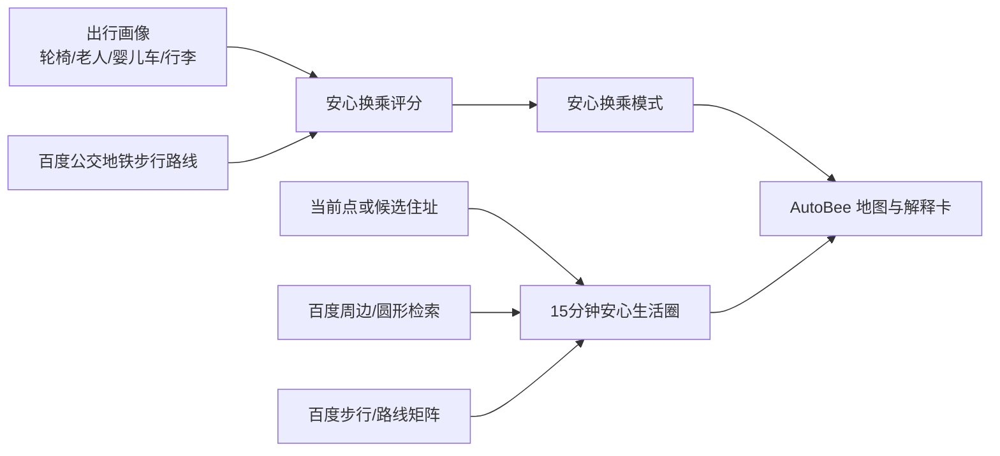
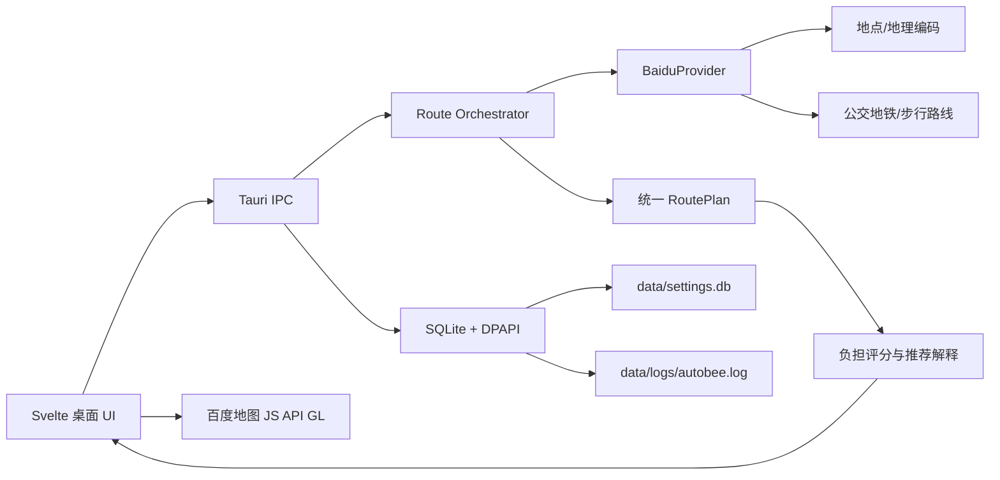

# AutoBee：无障碍换乘决策助手

## 0. 外部调研与可借鉴方向

本节不是照搬第三方项目，而是提取可迁移的产品机制，并明确哪些部分适合百度地图大赛。

### 0.1 可借鉴项目

| 项目 | 已验证的核心机制 | AutoBee 的借鉴方式 | 不直接照搬的部分 |
| --- | --- | --- | --- |
| [AccessMap](https://github.com/AccessMap/AccessMap) | 将人行网络和轮椅成本模型结合，生成面向行动不便用户的安全/可通行路线；其部署还包含 GeoJSON 人行数据、路由引擎和成本 profile | 把“路线”从一个时间结果扩展为步行距离、最长步行、换乘次数和风险解释；后续可接百度 POI/设施数据 | 不在赛事首期自建完整人行图和路由引擎，避免数据工程大于产品演示 |
| [walkability-analysis](https://github.com/eemilhaa/walkability-analysis) | 不只计算到最近一个 POI，而是计算步行网络上到第 1/5/10 个服务点的可达性，形成城市级可达性热力图 | 增加“15 分钟生活圈”模式：用百度周边检索获取医院、卫生间、药店、便利店等 POI，计算用户位置到多个目标的可达时间 | 不把首期做成离线城市分析平台，先做用户当前路线附近的微型服务圈 |
| [awesome-openstreetmap](https://github.com/osmlab/awesome-openstreetmap) 中的 AccessMap、Visit Sights、Defikarte 等 | 地图应用围绕单一高价值决策：无障碍通行、自助游、急救设备分布，而不是堆地图按钮 | 保持一个鲜明主题：百度地图驱动的“出行决策助手”，再用设施/天气/实时状态增强证据 | 不做泛化地图工具，不同时实现旅游、社交、编辑器等无关方向 |
| [baidu-maps/bmap-cli-skills](https://github.com/baidu-maps/bmap-cli-skills) | 百度官方相关工具强调 API/AK 管理、地点搜索、路线导航和地图样式的组合接入 | 将百度能力拆成可验收的主链路，并把 AK、调用额度、失败状态做成可演示的工程能力 | 不依赖 AI 工具自动生成代码；参赛作品的核心行为必须可解释、可复现 |

### 0.2 候选创意路线

不要只押一个创意。以下四个方向都能用百度地图能力形成作品；推荐先做 A，再把 B 作为增强演示，C/D 作为备选提交作品。

#### A. AutoBee 无障碍换乘决策助手（推荐）

- **用户**：轮椅、老人、婴儿车、行李用户。
- **百度核心**：地图 GL、地点输入提示、公交/地铁路线、步行路线、周边检索。
- **差异**：不是找最快，而是解释“为什么这条更适合你”。
- **实现风险**：低至中；路线与 POI API 能先完成，设施数据可以诚实标记“待确认”。

#### B. AutoBee 城市应急避险路线

- **用户**：暴雨、施工、事故、大型活动期间的城市出行者。
- **百度核心**：实时路况、交通管制/施工/事故、天气、路线规划、周边医院/避难场所/药店检索。
- **差异**：路线不只显示“最快”，还显示“风险来源”和“替代路线”。
- **实现风险**：中至高；实时数据权限、接口配额和演示时的现场数据稳定性需要提前验证。
- **适合**：百度有动态数据权限、能拿到稳定现场数据时作为第二作品。

#### C. AutoBee 15 分钟安心生活圈

- **用户**：新居民、老年人、亲子家庭、租房决策者。
- **百度核心**：当前位置、圆形/多边形/周边检索、步行路线、地图可视化、行政区划。
- **差异**：在地图上显示“15 分钟可达的医院、菜场、药店、卫生间、地铁站”，并比较不同住址的生活覆盖率。
- **实现风险**：中；POI 类别和路线查询次数需要缓存/限流，但 Demo 很直观，公众投票传播性强。

#### D. AutoBee 城市微旅行生成器

- **用户**：周末游客、亲子用户、短时转机旅客。
- **百度核心**：景点/餐饮/厕所/地铁 POI 检索、步行和公交路线、路线矩阵、地图线路展示。
- **差异**：根据时间、预算、步行耐受度生成“可执行的一小时/半日路线”，不是静态景点列表。
- **实现风险**：中；创意直观但同质化更高，需要加入“人少/室内/亲子/雨天”等强场景标签。

### 0.3 方案选择结论

**主作品选择 A**：它最能复用 AutoBee 当前架构，同时把百度 API/SDK 变成核心能力；可在 8 分钟路演中用一个真实场景讲清楚问题、技术和价值。

**增强演示选择 B 或 C**：

- 有动态数据权限：加 B 的“风险解释卡”，形成技术深度亮点。
- 没有动态数据权限：加 C 的“15 分钟安心生活圈”，用百度 POI 检索和路线规划保证可复现。

**不推荐首期选择 D**：旅游规划视觉上讨喜，但地图比赛中同质化高，且容易变成景点列表，难以拿到技术深度分。

### 0.4 三类研究融合后的产品形态

不引入第三方项目的服务端、地图数据或依赖；融合可验证的产品机制，避免数据授权、部署复杂度和赛事“百度地图为核心”要求相互冲突。



#### 模式一：安心换乘（AccessMap 机制）

**目的**：用户不是选择“最快”，而是选择对自己最可执行的路线。

| 出行画像 | 权重变化 | 推荐解释示例 |
| --- | --- | --- |
| 普通通勤 | 时间、换乘均衡 | 比最快方案多 3 分钟，少换乘 1 次 |
| 拖行李 | 提高总步行、最长单段步行权重 | 避免 760 米连续步行，适合携带行李 |
| 老人/行动缓慢 | 提高换乘、最长步行、设施未知权重 | 换乘少，步行段更短，请预留 8 分钟余量 |
| 婴儿车 | 提高步行和换乘权重 | 少一次上下换乘，路径更稳定 |

**首期数据边界**：百度路线结果可直接提供路线、步行段、交通分段与站点；“电梯可用”不能靠猜测生成。设施不足时显示“需确认站内无障碍设施”，而不是伪造无障碍承诺。

**后续增强**：用户可对路线提交“此出口有/无电梯”“施工绕行”等本地反馈；反馈必须带时间、地点和审核状态，不能直接改写官方地图事实。

#### 模式二：15 分钟安心生活圈（walkability-analysis 机制）

**目的**：把“这个地方附近有什么”升级为“我步行 15 分钟实际上能稳定获得哪些服务”。

用户输入当前位置、候选住址或点击地图后，选择服务包：

```text
就医安心包：医院 / 药店 / 卫生间
亲子安心包：母婴室 / 公园 / 便利店 / 地铁站
通勤安心包：地铁站 / 公交站 / 共享单车 / 便利店
应急安心包：医院 / 药店 / 警务服务 / 24小时便利店
```

处理流程：

1. 用百度圆形或周边检索按类别取得 POI 候选。
2. 对候选点调用百度步行路线或路线矩阵，得到真实可达时间；不能用直线距离代替。
3. 按 5/10/15 分钟分层，并计算每类设施数量、最近一个、第三近一个和最短可达时间。
4. 地图显示等时圈、POI 点位和一条推荐步行路径。
5. 输出空白项而不是虚假完备性，例如“15 分钟内未找到药店；建议扩大至 20 分钟”。

这比“最近 POI”更稳健：单个异常点不会决定整个居住/出行判断，多类别服务覆盖才形成真实生活可达性。

#### 模式三：场景化地图任务（Awesome OpenStreetMap 的产品原则）

`awesome-openstreetmap` 是项目索引，价值在于它列出的成功地图产品几乎都有**一个清楚的决策问题**。AutoBee 遵守三个约束：

1. 一个页面只回答一个问题：此刻如何换乘，或此处 15 分钟能获得什么服务。
2. 每个地图图层都能转化为行动：选路线、看风险、导航至服务点；不做装饰性图层。
3. 先固定南京/北京两个高质量演示城市，再扩展；避免用泛全国空数据演示削弱可信度。

### 0.5 参赛版本功能切片

| 优先级 | 功能 | 来源机制 | 百度核心能力 | 赛事价值 |
| --- | --- | --- | --- | --- |
| P0 | 百度地图、POI 联想、地铁/公交/步行规划 | 现有 AutoBee | JS API GL、地点输入提示、路线规划 | 参赛合规基础 |
| P0 | 安心换乘评分与“为什么推荐” | AccessMap | 路线分段、地点与站点数据 | 创意性与技术深度 |
| P1 | 15 分钟安心生活圈 | walkability-analysis | 圆形/周边检索、步行路线/路线矩阵 | 公众投票传播与实用性 |
| P1 | 用户画像切换 | AccessMap | 路线规划结果 | 现场演示变化直观 |
| P2 | 站点设施众包反馈 | AccessMap/地图任务模式 | 地点检索、位置/轨迹能力 | 长期数据壁垒；不阻塞首期 |
| P2 | 施工、天气、实时公交风险解释 | 应急避险方向 | 百度动态数据 | 数据权限可用时增强技术深度 |

**提交收敛**：P0 必须全部完成；P1 至少完成生活圈中的一个服务包；P2 只在 API 权限、数据稳定性和演示时间允许时加入。

### 0.6 当前实现状态（2026-09-23）

已融入 AutoBee 的源码：

- `src/lib/domain/accessibility.ts`：从现有统一 `Route` 计算总步行、最长步行、线路变更次数；按普通、行李/婴儿车、老人/行动缓慢画像给候选方案排序。
- `src/lib/components/app/RouteCard.svelte`：展示可解释的负担原因；在长步行或非普通画像存在换乘时显示“设施无障碍信息待确认”。
- `src/lib/state/planner.svelte.ts`：切换画像只对当前候选本地重排，不重复调用路线 API。
- `src/lib/domain/accessibility.test.ts`：覆盖负担指标、行李画像排序和长步行提示。

尚未实现且必须使用百度数据完成的部分：

- 15 分钟生活圈的多 POI 检索与真实步行时间分层。
- 电梯、坡度、路缘坡道、施工与实时公交的事实证据。
- 百度 `BaiduProvider` 与 JS API GL 主链路。

因此当前版本只能称为“基于路线分段的低步行/少换乘建议”，不能称为完整无障碍导航。

## 1. 参赛定位

**一句话**：为行动不便、携带行李、推婴儿车及首次到访城市的用户，把“能到”升级为“能顺利到”的公共交通决策助手。

AutoBee 不是又一个路线查询页。它把百度地图的地点、公交/地铁路线、步行路径与地图展示能力作为主链路，针对每一段换乘给出可执行的解释：从哪个出口出、是否需要长距离步行、换乘次数是否过多、哪条方案对当前用户更稳妥。

**作品名称**：AutoBee 无障碍换乘决策助手

**目标用户**：

- 使用轮椅、拐杖或行动速度较慢的人。
- 推婴儿车、拖行李箱的通勤和旅行用户。
- 对陌生城市地铁换乘缺乏信心的老年人与首次到访者。
- 希望减少换乘风险而非只追求最短时间的普通用户。

**核心价值**：路线结果以“换乘负担”而非“距离/时间”作为另一套可解释的评价维度。用户可以在时间最短、少换乘、低步行、无障碍优先之间选择，理解每个建议的取舍。

## 2. 与赛事规则的对应

| 评分维度 | 设计回应 | 可展示证据 |
| --- | --- | --- |
| 创意性 30% | 从通用导航转为面向真实出行障碍的换乘决策；同一组路线给出“为什么推荐”的可解释结论 | 一键切换“时间最短/低步行/少换乘/无障碍优先”，方案排序与理由同步变化 |
| 技术深度 30% | 百度地图 SDK GL、地点建议、地理编码、步行与公交/地铁路线服务、逆地理编码/路线矩阵按需组合；本地策略引擎对分段路线重新评分 | API 调用链、分段标准化模型、评分公式、降级与坐标系处理、缓存与日志 |
| 实用性 25% | 解决“路线能查到但不敢走”的实际问题，第一期即能覆盖地铁、公交、步行、陌生城市换乘 | 南京或北京真实站点场景的可交互 Demo；路线步骤、步行负担、换乘风险说明 |
| 展示完整度 15% | 完整桌面 Demo、3 分钟录屏、8 分钟路演脚本、真实 API Key 配置指引、可复现实例 | 可安装包、演示视频、README/设计图、测试与异常提示 |

## 3. 问题与场景

### 3.1 用户问题

普通导航主要按时间和距离排序，但“步行 700 米 + 两次换乘”对于拖箱用户的代价，远高于同样时间的“一次换乘 + 步行 100 米”。现有结果也很少在路线决策前明确说明这类负担。

### 3.2 首期场景

**场景 A：南京站到孝陵卫地铁站**

- 用户拖 26 寸行李箱。
- 默认路线可能更快，但包含长通道、较多步行或多次换乘。
- AutoBee 对比“时间最短”和“低步行”方案，标出总步行、最长单段步行、换乘次数与每段行动指令。

**场景 B：陌生城市地铁换乘**

- 用户从机场到医院或考试地点。
- 选择“少换乘”后，系统重新排序并在地图上只强调推荐路线。
- 用户可查看上车站、下车站、行进方向和预估步行负担。

**场景 C：临时改用步行**

- 用户在地铁、公交、步行间切换。
- 地图视图立即按新的起终点和路线重新定位；不会停在上一次路线或默认城市中心。

## 4. 产品体验

### 4.1 主界面

- 起点与终点：输入即展示地点联想；选中候选后锁定坐标。
- 出行方式：地铁、公交、步行。
- 决策目标：时间最短、距离最短、少换乘、低步行、无障碍优先。
- 地图：百度地图 JS API GL 作为主地图；展示道路、地铁网络、站点、当前方案折线、起终点。
- 方案卡：总时间、总距离、票价、总步行、换乘次数、推荐理由。
- 步骤详情：步行段、线路名、上下车站、站数、方向、出口提示及风险标签。

### 4.2 决策标签

| 标签 | 触发条件 | 面向用户的文案 |
| --- | --- | --- |
| 低步行 | 总步行或最长单段步行在候选中最低 | 步行负担最低 |
| 少换乘 | 乘车线路变更次数最低 | 换乘次数最少 |
| 直达优先 | 全程单条线路或无公共交通换乘 | 路线更直接 |
| 时间最短 | 预估时间最低 | 预计最快到达 |
| 长步行提醒 | 单步行段超过阈值，例如 500 米 | 含较长步行，请留意体力与行李 |
| 多换乘提醒 | 换乘次数超过阈值，例如 2 次 | 换乘较多，建议预留时间 |

阈值必须进入设置或策略配置，不应写死在 UI。首期默认阈值采用保守值，并在路演中说明其可配置性。

## 5. 百度地图开放平台集成设计

### 5.1 百度能力作为核心链路

| 能力 | 百度服务 | 作用 | 首期实现 |
| --- | --- | --- | --- |
| 主地图 | JavaScript API GL | 渲染地图、地铁网络、站点、路线覆盖、视图定位 | 必做 |
| 地点联想 | 地点检索/输入提示服务 | 起终点模糊输入转候选 POI | 必做 |
| 地理编码 | 地理编码服务 | 用户直接输入地址时得到经纬度 | 必做 |
| 公交/地铁路线 | 路线规划服务 | 获取公交、地铁、换乘与步行分段 | 必做 |
| 步行路线 | 步行路线规划服务 | 获取纯步行路线和详细路径 | 必做 |
| 路线矩阵 | 路线矩阵服务 | 多候选点或多目的地的快速时间/距离比较 | 第二阶段 |
| 逆地理编码 | 逆地理编码服务 | 地图点选位置的人类可读地址 | 第二阶段 |
| 周边检索 | Place API/POI 检索 | 无障碍入口、卫生间、电梯、停车场等候选设施 | 第二阶段 |

最终提交前，必须以比赛时可用的百度开发者 AK 替换示例 Key，并配置合法的应用类型、域名或包名限制。

### 5.2 不把百度只当底图

比赛作品必须由百度能力驱动核心功能，因此设定以下验收门槛：

1. 默认 provider 是 `baidu`，没有百度 AK 时主功能显示明确配置提示。
2. POI 联想、地址解析、地铁/公交与步行路线至少四条主链路都通过百度服务。
3. 地图使用百度 JS API GL，不使用其他地图 SDK 作为主视图。
4. 方案评分只消费百度返回后标准化的分段结果，保证数据链路可解释。
5. 录屏必须展示浏览器网络面板或开发日志中百度请求成功的证据，注意脱敏 AK。

### 5.3 AutoBee Provider Adapter

现有 Rust 核心已有 `RouteProvider` 抽象，百度接入采用一个 `BaiduProvider`：

```text
百度地点联想 / 地理编码 / 路线规划
        ↓
BaiduProvider
        ↓

Place / RoutePlan / Route / Segment / TransitLine
        ↓
负担评分器 + 可解释推荐
        ↓
Svelte UI + 百度地图 GL 覆盖层
```

`BaiduProvider` 负责：

- API 参数编码、AK 注入和上游错误映射。
- 将百度坐标统一标为 `BD09`。
- 将原始公交/地铁分段映射为统一的 `Segment` 与 `TransitLine`。
- 将百度坐标转换为地图与输出选择的目标坐标系。
- 保留原始 provider 名称和失败原因，便于降级说明与诊断。

禁止在前端直接调用需要保密的 Web 服务 AK。桌面端将 AK 加密存入 `data/settings.db`，由 Rust 通过 HTTPS 请求；若 JS API GL 需要浏览器端 AK，使用与 Web/桌面来源绑定的受限 AK，且在设置中标明用途。

## 6. 路线负担评分

### 6.1 统一指标

从标准化 `Route` 与 `Segment` 计算：

- `duration_min`：总耗时。
- `distance_m`：总距离。
- `walk_m`：所有步行段距离和。
- `max_walk_m`：最长单一步行段。
- `transfers`：公交/地铁线路切换次数。
- `transit_segments`：乘车段数量。
- `unknown_accessibility`：无法确认电梯/无障碍设施的站点数量，首期仅做预留字段。

### 6.2 可解释评分公式

第一期不声称“绝对无障碍”。使用透明、可调的负担分数：

```text
burden = 0.45 × norm(walk_m)
       + 0.25 × norm(max_walk_m)
       + 0.20 × norm(transfers)
       + 0.10 × norm(duration_min)
```

推荐排序：

- 时间最短：`duration_min` 升序。
- 距离最短：`distance_m` 升序。
- 少换乘：`transfers`、`walk_m`、`duration_min` 依次升序。
- 低步行：`walk_m`、`max_walk_m`、`transfers` 依次升序。
- 无障碍优先：`burden` 升序；待接入设施数据后加上 `unknown_accessibility` 惩罚。

每一个推荐都必须生成解释，例如：

> 推荐方案 2：比最快方案多 6 分钟，但少走 820 米、少换乘 1 次。

### 6.3 诚信边界

- 未接入站内电梯、坡道、施工和实时拥挤度数据前，界面称为“低步行/少换乘建议”，不能承诺“全程无障碍”。
- 首期只给“需要人工确认”的风险提示，不捏造设施可用性。
- 接入百度周边检索或官方无障碍数据后，才升级为站点设施证据卡片。

## 7. 技术架构



### 7.1 现有工程可复用部分

- `RouteProvider`：复用 provider 接口与降级链。
- `Place`、`RoutePlan`、`Route`、`Segment`：复用归一化 DTO。
- `convert_plan`：复用坐标系转换。
- `PlannerState`：复用防抖联想、路线请求、模式切换时重算。
- 设置页：复用加密 Key 存储、测试 Key、优先级、启用/停用。
- 本地数据目录：复用 `data/settings.db`、`data/logs/autobee.log`。

### 7.2 新增模块

```text
src-tauri/core/src/providers/baidu.rs    # 百度 API adapter
src-tauri/core/src/accessibility.rs      # 负担指标、排序与推荐理由
src/lib/domain/accessibility.ts          # 前端展示模型和格式化
src/lib/components/app/Recommendation.svelte
src/lib/components/app/AccessibilityFilter.svelte
docs/AutoBee-百度地图大赛设计方案.md
```

## 8. 实施计划

### M1：百度主链路可用（2 至 3 天）

1. 创建百度地图开放平台应用，分别获取 Web 服务 AK 和 JS API GL AK。
2. 实现 `BaiduProvider::suggest`、`geocode`、`plan_route`。
3. 将百度标记为已实现且默认优先级设为 1。
4. 用百度 JS API GL 替换当前主地图。
5. 验收：输入 POI、选点、地铁/公交/步行规划和路线覆盖全部来自百度。

### M2：负担评分与解释（2 天）

1. 提取步行、最长步行与换乘次数。
2. 增加四种决策目标和确定性排序。
3. 增加推荐理由卡片与风险标签。
4. 验收：同一对起终点切换目标后，排序和解释可见变化。

### M3：展示完整度（1 至 2 天）

1. 固化南京和北京两个可稳定演示场景。
2. 制作引导状态、错误状态、无 AK 状态、网络失败状态。
3. 录制 3 分钟 Demo 视频与 8 分钟路演视频。
4. 准备截图、架构图、测试报告和 README。

## 9. Demo 脚本

### 3 分钟视频

1. **0:00–0:20**：问题开场。拖行李箱的用户不只需要最快路线，还需要少走、少换乘。
2. **0:20–0:45**：输入“孝陵卫地铁站 → 南京南站”，展示百度地点联想与地图定位。
3. **0:45–1:20**：展示时间最短路线。
4. **1:20–1:55**：切换“低步行”，方案排序变化，解释“多 6 分钟，少走 820 米、少换乘 1 次”。
5. **1:55–2:25**：切换步行，地图和方案详情同步改为纯步行，视图重新 fit。
6. **2:25–2:50**：打开设置，展示百度 AK 安全配置、Key 测试、数据在 exe 同目录 `data` 下。
7. **2:50–3:00**：总结百度地图服务如何覆盖“找点—算路—看图—决策”。

### 8 分钟路演

| 时间 | 内容 |
| --- | --- |
| 0:00–0:45 | 目标用户与真实痛点 |
| 0:45–2:00 | 现场 Demo：地点联想与路线 |
| 2:00–3:30 | 现场 Demo：低步行/少换乘重新排序 |
| 3:30–4:45 | 百度能力调用链与坐标处理 |
| 4:45–5:45 | 评分公式、可解释推荐、诚信边界 |
| 5:45–6:45 | 工程质量：本地加密、日志、测试、降级 |
| 6:45–7:30 | 后续：无障碍设施、实时状态、路线矩阵 |
| 7:30–8:00 | 总结与 Q&A 引导 |

## 10. 提交清单

- [ ] 百度地图开放平台应用截图，敏感 AK 打码。
- [ ] 可安装 Windows Demo：`AutoBee.exe` 或安装包。
- [ ] 3 分钟演示视频。
- [ ] 8 分钟路演稿与备用录屏。
- [ ] README：运行方式、AK 配置、体验场景、已知边界。
- [ ] 架构图、评分公式与测试截图。
- [ ] 原创声明与开源依赖清单。
- [ ] 投票页文案：一句话价值、三张核心截图、30 秒短视频。

## 11. 风险与规避

| 风险 | 影响 | 处理 |
| --- | --- | --- |
| 百度 AK 类型或白名单配置不正确 | 地图或 Web 服务不可用 | 把 JS API GL AK 与 Web 服务 AK 分开配置；Demo 前用固定场景实测 |
| 地图 SDK 外部资源加载失败 | 地图白屏 | 发布前在安装包环境验证；提供明确错误提示与日志路径 |
| 公交路线分段字段存在城市差异 | 详情展示不完整 | Adapter 使用 Option/默认值，保留原始错误日志；固定演示城市回归测试 |
| 无障碍数据不完整 | 误导用户 | 首期明确为“低步行/少换乘建议”，设施未知时提示用户确认 |
| 现场网络波动 | 演示失败 | 提前缓存地图、录制离线备份视频、准备可复现截图 |
| 多 provider 反而削弱百度核心性 | 不符合赛事要求 | 赛事版本默认百度主链路，其他 provider 仅作为故障兜底且不在主 Demo 占比 |

## 12. 成功标准

参赛版本达到以下条件才提交：

1. 无百度 AK 时明确提示配置；有 AK 时主流程稳定使用百度服务。
2. 起终点联想、地铁/公交/步行路线、地图覆盖四项均可现场演示。
3. 切换决策目标或出行方式后，方案与地图同步更新。
4. 至少一个演示场景能清楚证明“低步行/少换乘”与“最快”不同。
5. 评分逻辑透明、说明边界，不虚构无障碍设施数据。
6. 打包 Demo、视频、路演稿、截图和投票页素材齐全。
## 7.3 参赛版页面重构方案

### 页面定位

当前页面把“路线输入、路线列表、地图”并排放置，适合工具，但没有把作品的差异化说出来。参赛版应让用户先理解 **为什么这条路线适合我**，再看路线细节；生活圈不能藏在路线设置之下，而应成为并列的地图决策模式。

### 信息架构

```text
顶部：AutoBee 安心出行
├─ 模式切换
│  ├─ 安心换乘
│  └─ 15 分钟生活圈
├─ 左侧决策面板
│  ├─ 起点 / 终点 或 生活圈中心
│  ├─ 出行画像
│  ├─ 出行方式 / 服务包
│  ├─ 推荐结论卡
│  └─ 路线或 POI 清单
└─ 右侧百度地图
   ├─ 推荐路线 / 服务点
   ├─ 15 分钟范围
   ├─ 风险或设施未知提示
   └─ 图例与百度数据来源
```

### 顶部结构

| 区域 | 内容 | 行为 |
| --- | --- | --- |
| 品牌 | `AutoBee 安心出行` + 一句副标题“少走一点，安心一点” | 不显示“路线规划”这类通用工具名 |
| 一级模式 | `安心换乘`、`15 分钟生活圈` | 切换时保留当前地点；地图和左侧面板按模式换内容 |
| 数据标识 | `百度地图驱动` | 打开“使用了哪些百度服务”的抽屉，录屏时可展示 |
| 设置 | 百度 Web 服务 AK、百度 JS API GL AK、画像阈值、日志目录 | 保留现有加密存储能力 |

### 模式一：安心换乘

#### 左侧面板优先级

1. **起点、终点**：地点输入提示；选中后锁定 POI 坐标。
2. **谁在出行**：普通出行、行李/婴儿车、老人/行动缓慢；不要把它藏在一个无说明的下拉框里。
3. **本次目标**：时间最短、低步行、少换乘。
4. **推荐结论卡**：置于所有路线卡前面。
5. **候选路线卡**：显示差异，不只是时长与距离。

#### 推荐结论卡

```text
为「行李 / 婴儿车」推荐方案 2
预计 51 分钟 · 步行 420 米 · 1 次换乘

比最快方案多 5 分钟，少走 680 米，少换乘 1 次。
[查看为什么]  [改为时间最短]
```

卡片必须由真实分段指标生成。无法从百度路线结果确认的设施信息，统一使用：

```text
站内电梯/无障碍设施需确认
```

禁止使用“无障碍路线”“全程可通行”等绝对语言，除非后续接入可验证的设施数据。

#### 路线卡视觉层级

| 层级 | 必须内容 | 用途 |
| --- | --- | --- |
| 首行 | 总时长、总步行、换乘次数 | 用户快速比较 |
| 第二行 | `低步行` / `少换乘` / `最长步行 620 米` 标签 | 体现评分模型 |
| 第三行 | 一句解释 | 将算法翻译为行动取舍 |
| 展开区 | 上下车站、方向、站数、步行指令 | 出发前执行 |

### 模式二：15 分钟生活圈

#### 左侧面板

```text
中心地点：当前位置 / 地图点选 / 输入地址
服务包：[就医安心] [亲子安心] [应急安心]
范围：15 分钟步行（固定，明确可比较）

结果摘要
15 分钟内找到 7 个服务点
医院 1 · 药店 3 · 卫生间 3

最近服务
药店 · 国胜大药房 · 步行 4 分钟
医院 · XX 社区卫生服务中心 · 步行 11 分钟

缺口提示
15 分钟内未找到卫生间；可扩大到 20 分钟继续检索
```

#### 地图图层

1. 中心点：用户选择的位置。
2. 服务点：按类别着色，医院红、药店蓝、卫生间紫、亲子绿、应急橙。
3. 可达性：每个点都必须有百度真实步行时间，不用直线半径冒充步行可达范围。
4. 选中服务点：展示名称、地址、步行距离/时间，并可切换为“去这里”。
5. 图例：明确“数据来源：百度地点检索 + 百度步行路线”。

### 地图与页面联动

| 用户行为 | 页面变化 | 地图变化 |
| --- | --- | --- |
| 切换出行画像 | 候选路线重排，推荐理由更新 | 高亮新方案并 fit 至起终点 |
| 切换地铁/公交/步行 | 重新调用路线服务 | 清除旧折线、渲染新路线并重新定位 |
| 点击候选路线 | 对应卡片展开 | 高亮此路线，其他路线降权或隐藏 |
| 选择生活圈服务包 | POI 结果与统计更新 | 清除旧 POI，绘制新类别点位 |
| 点击一个服务点 | 展开服务详情 | 高亮点位，显示真实步行时间 |

### 空、错、加载状态

| 状态 | 文案 | UI 行为 |
| --- | --- | --- |
| 没有百度 AK | “填写百度 Web 服务 AK 后即可计算生活圈” | 提供跳转设置按钮，不显示伪数据 |
| 没有起点 | “先选一个地点，看看 15 分钟内能获得哪些服务” | 生活圈按钮禁用或解释原因 |
| 检索中 | “正在检索 POI，并逐个验证真实步行时间” | 进度骨架，避免只显示笼统加载圈 |
| 某类别无结果 | “15 分钟内未找到药店” | 明确显示缺口；可提供扩大范围入口（第二期） |
| 服务异常 | “百度地点检索暂不可用，请重试” | 显示错误码摘要，详情写入本地日志 |

### 3 分钟演示镜头设计

1. **0:00–0:20**：安心换乘首页，选择“行李/婴儿车”。
2. **0:20–0:55**：输入孝陵卫地铁站到南京南站，出现路线和推荐理由。
3. **0:55–1:20**：切换“时间最短”，对比推荐理由与路线变化。
4. **1:20–1:45**：切换到“15 分钟生活圈”，中心仍是孝陵卫站。
5. **1:45–2:20**：选择“就医安心”，展示药店/医院点位及真实步行分钟数。
6. **2:20–2:40**：点击一个药店，展示“步行 4 分钟”；强调不是直线距离。
7. **2:40–3:00**：展示“百度地图驱动”抽屉、数据来源、AK 安全配置与产品价值总结。

### 落地顺序

1. 把现有路线页重命名和分区为“安心换乘”。
2. 将当前画像下拉改为可见的画像卡片组，并增加推荐结论卡。
3. 将已有生活圈组件从路线控件下移为一级模式。
4. 为生活圈增加类别图例、服务点选择和空状态。
5. 等百度 JS API GL 接入后，替换当前腾讯地图为百度主地图，保留相同页面契约。
